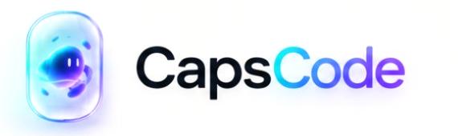
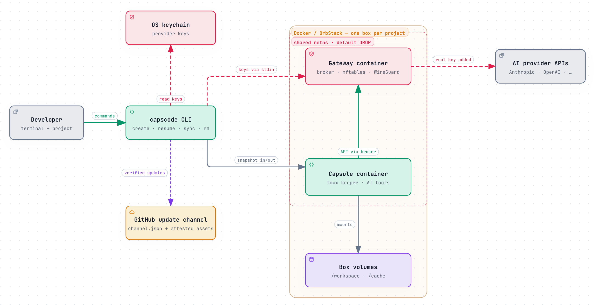

<h1 align="center">
  <picture>
    <source media="(prefers-color-scheme: dark)" srcset="docs/assets/wordmark-dark.png">
    
  </picture>
</h1>

<p align="center">
  <a href="https://sayre4ux.github.io/capscode/"><b>Documentation</b></a> ·
  <a href="#install">Install</a> ·
  <a href="#use-it">Use it</a> ·
  <a href="#architecture">Architecture</a> ·
  <a href="#limitations">Limitations</a> ·
  <a href="docs/roadmap.md">Roadmap</a> ·
  <a href="SECURITY.md">Security</a>
</p>

**Isolated Docker capsules for AI coding tools.** Run `claude`, `codex`, `opencode`, `pi`, or
`omp` in a container with a private copy of your project, credentials held outside the
container, and network containment. You decide what comes back to your host.

```bash
cd ~/my-project
capscode claude
```

> **Status:** v0.1, the first public release. Tested on macOS (Apple silicon) with OrbStack, and
> on Ubuntu 24.04 (arm64) with Docker Engine for install, `doctor`, and one-shot sessions.
> Docker Desktop and x86-64 are untested. See [Limitations](#limitations).

## What it protects (and what it doesn't)

**It protects:**

- **Your host from the tool.** The agent runs as an unprivileged user in a read-only-rootfs
  container. In copy mode it cannot read `~/.ssh`, `~/.aws`, your keychain, your other
  repositories, or your shell history.
- **Your credentials from the tool.** The real key or token goes to a separate gateway
  container. The capsule and `docker inspect` see only sentinels.
- **Your host environment from the capsule.** Each run gets a fresh, normalized identity, no
  inherited dotfiles or MCP config, and known telemetry endpoints are blocked.
- **Your private network.** Host, LAN, and cloud-metadata addresses are blocked. A WireGuard
  config adds a fail-closed VPN tunnel.

**It does not protect:**

- **Your identity to the AI provider.** The provider receives your account, key, and code.
- **Against data leaving over the public internet.** Public egress is not filtered by
  destination; tunnel mode changes the route, not what is sent.
- **Against provider-side behavioral signals** such as request timing and prompt style.

The [threat model](docs/threat-model.md) lists the trust boundaries and known residual risks.

## Install

You need macOS or Linux (glibc 2.35+), Docker with BuildKit running (OrbStack, Docker Desktop, or
Docker Engine), `curl`, `tar`, and about 10 GB of free disk.

```bash
curl -fsSL https://raw.githubusercontent.com/sayre4ux/capscode/main/scripts/install.sh | bash
```

The installer checks requirements before changing anything, downloads and checksums the release
binary, builds the container images locally (CapsCode publishes no images), and runs
`capscode init`. On macOS, choose **Always Allow** the first time CapsCode reads the keychain
after an install or update. See [Install](docs/install.md) for options, building from source,
and the supply chain. To install with an AI coding agent, ask it to follow
[BOOTSTRAP.md](BOOTSTRAP.md).

## Use it

**One-shot session.** Run a tool in a fresh capsule. On exit, CapsCode shows what changed and
lets you save it to a branch, apply it, review the diff, or discard it:

```bash
capscode codex
capscode codex exec "summarize this project"   # batch runs save changes to a branch
```

**Box.** A persistent project environment with every tool installed:

```bash
cd ~/projects/abc
capscode create abc     # prints a unique name such as abc-k3f9x2
capscode                # enter it; run claude, codex, ... inside; Ctrl-b d detaches
capscode sync abc       # copy work back to the host
capscode rm abc         # copy work back and remove the box
```

**Credentials.** Bring your own: an API key in the environment (`ANTHROPIC_API_KEY`,
`OPENAI_API_KEY`, ...), a Claude setup token, your existing Codex login, or keys stored with
`capscode key set <provider>`. `capscode doctor` checks the runtime, credentials, and network
containment.

## Documentation

The same pages are published at <https://sayre4ux.github.io/capscode/>.

| Page | Covers |
|---|---|
| [Install](docs/install.md) | Requirements, installer options, building from source, supply chain |
| [Authentication](docs/authentication.md) | API keys, subscriptions, keychain storage, providers |
| [Boxes](docs/boxes.md) | Create, enter, sync, resume, cache volumes, mount mode |
| [How your files are handled](docs/files.md) | Git snapshots, copy-back, branches, non-git folders |
| [Networking](docs/networking.md) | Containment-only mode, WireGuard tunnel, egress checks |
| [Tool versions and updates](docs/toolchain.md) | Pinned toolchains, `capscode update`, verifying releases |
| [CLI reference](docs/cli.md) | Every command, option, and config key |
| [Threat model](docs/threat-model.md) | Trust boundaries and residual risks |
| [Roadmap](docs/roadmap.md) | Planned work and non-goals |

## Architecture

<p align="center">
  <picture>
    <source media="(prefers-color-scheme: dark)" srcset="docs/assets/architecture-dark.png">
    
  </picture>
</p>

[Open the interactive diagram](https://sayre4ux.github.io/capscode/architecture.html): each box links to the code behind it.

The capsule shares only the gateway's *network* namespace, not its process or filesystem
namespace, so a compromised capsule can reach the broker but cannot read the key it holds. A box
runs the same gateway and capsule pair, with a `tmux` shell that survives detaching.

## Limitations

- **Docker or OrbStack only** for now. On Linux, boxes and tunnel mode are not yet tested, and
  VPN needs `/dev/net/tun` and `NET_ADMIN` in the container VM. Windows is future work.
- **Images are large.** The merged all-tools image used by boxes is about 2.4 GB, built locally
  with `capscode toolchain build`.
- **Mount mode has no crash insurance.** The box's periodic checkpoint commit is off there, since
  it would write to your real repository.
- **Copy-back never applies deletions.** Deleted files, symlinks, and type changes are reported,
  not applied. Conflicted files are left in the session's `staging/` directory.
- **Repeated `sync` reports more conflicts over time,** because the comparison baseline is fixed
  when the session starts. Nothing is lost; the fix is being designed.

`previous-handoff.<n>` directories are kept until `capscode rm <box>`, since each may hold the
only copy of a conflicted or overwritten file.

## License

Apache-2.0. CapsCode is not affiliated with Anthropic, OpenAI, or other providers.
