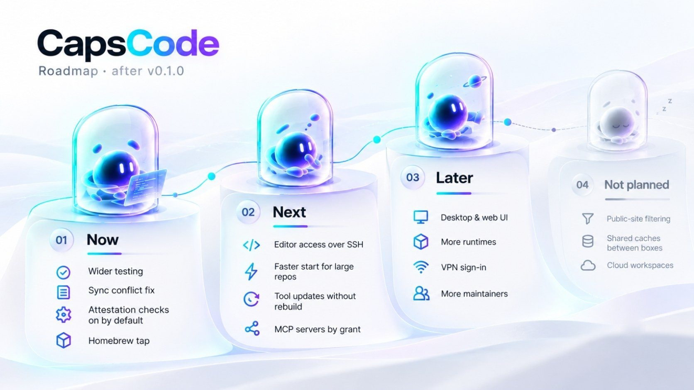

# Roadmap

  <picture>
    <source media="(prefers-color-scheme: dark)" srcset="assets/roadmap-dark.jpg">
    
  </picture>

CapsCode is at v0.1.0, its first public release. This page lists what is planned and what is
deliberately left out. It has no dates: order within a section is rough priority, and plans
change as people use the tool. To suggest or discuss an item, open an issue.

## Now: make 0.1 solid

- **Wider testing.** Boxes and tunnel mode on Linux, Docker Desktop, and x86-64 hosts are not
  yet tested (see [Limitations](https://github.com/sayre4ux/capscode/blob/main/README.md#limitations)).
- **Attestation checks on by default.** Checking a release's GitHub attestation is opt-in today
  (`update.verify_with_gh`, `install.sh --verify-attestation`) because it needs the GitHub CLI.
  The goal is to verify attestations in CapsCode itself, so every update gets the check without
  extra tools.
- **Homebrew tap**, as an install path next to `install.sh` and the release binaries.

## Next

- **Editor access to a box.** Open a box from VS Code, Cursor, or JetBrains over a short-lived,
  box-only SSH connection, with editor telemetry off inside the capsule.
- **Faster start for large repositories.** An optional per-project cache of git objects, so a new
  session copies only what changed since the last one.
- **Tool updates without a full image rebuild.** Keep the AI tools in a read-only layer that can
  be swapped on its own, so moving one tool to a new version does not rebuild the 2.4 GB image.
- **MCP servers by grant.** Let a box use MCP servers you have approved for that project, instead
  of none at all.

## Later

- **A desktop and web interface.** See your boxes and what each agent is doing, review its
  changes, and approve sync from a window instead of the terminal. The CLI stays the primary
  interface.
- **More runtimes.** Apple's container runtime on macOS, and Windows through WSL2.
- **VPN sign-in.** Connect to a VPN provider with your account instead of importing a WireGuard
  file.
- **More maintainers.** Move the project to a GitHub organization with a second maintainer, and
  sign macOS binaries under that organization.

## Not planned

- **Filtering what the agent sends to public sites.** CapsCode keeps the agent away from your
  host, your real credentials, and your private network. It does not inspect or restrict which
  public destinations the agent talks to.
- **Caches shared between boxes.** Each box keeps its own `/cache`; a shared cache would let one
  project's agent leave files for another's.
- **Cloud-hosted workspaces.** CapsCode runs on your machine.
- **Hiding you from the model provider.** The provider still sees your account and everything the
  tool sends it.
